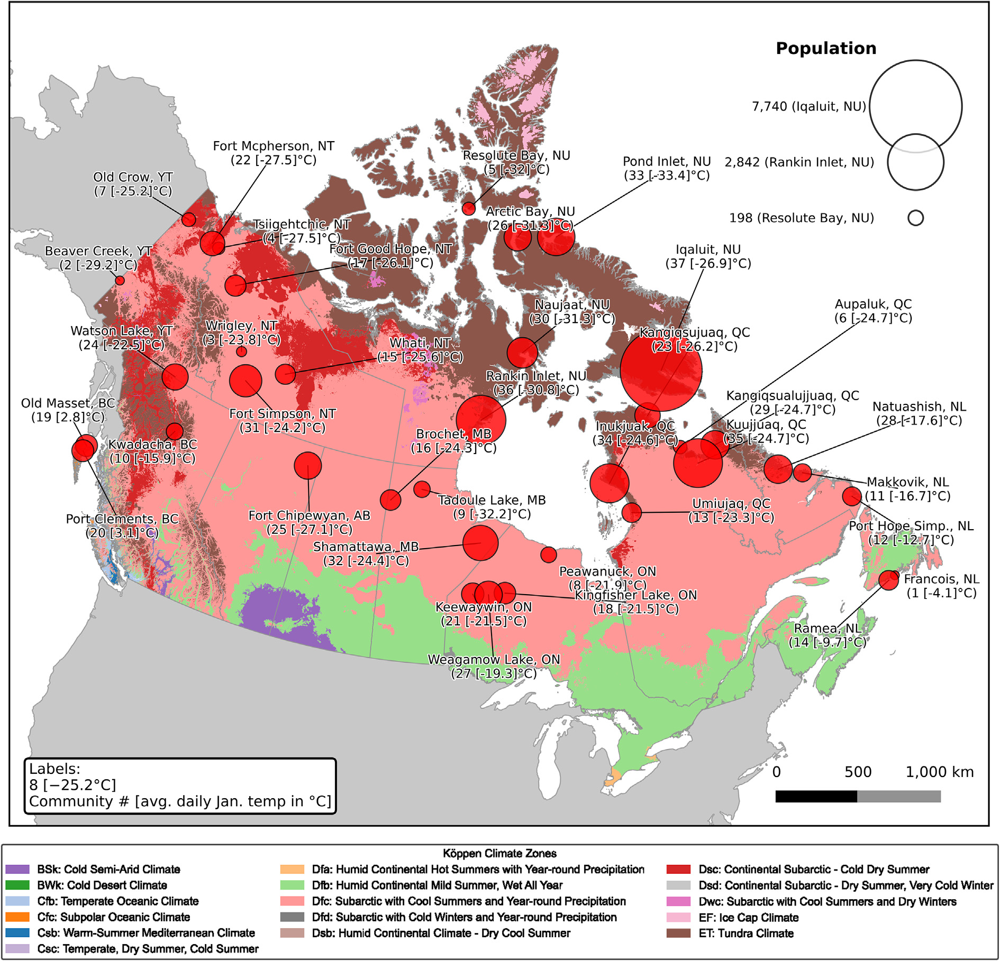

**Publication:** "Hydrogen microgrids to facilitate the clean energy transition in remote, northern communities", *Applied Energy*, 2025.

I. Maynard, **D. MacKay**, K. R. Schell, R. Kilpatrick, A. Abdulla

Most remote northern communities in Canada rely on diesel for electricity. We optimized hydrogen microgrid investments for 37 of them and found that hydrogen microgrids are cheaper than diesel, in levelized cost terms, in 28. That advantage depends heavily on wind costs: if wind capital costs rise to CAD 20,000/kW, only 3 communities still come out ahead.

The 37 remote northern communities analyzed. Fig. 1 from Maynard et al., <em>Applied Energy</em> (2025), <a href="https://creativecommons.org/licenses/by-nc-nd/4.0/">CC BY-NC-ND 4.0</a>.

<a class="button" href="https://doi.org/10.1016/j.apenergy.2025.126758">Read the paper (open access)</a>
